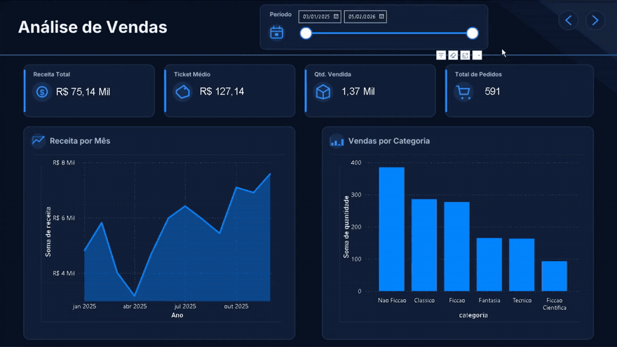
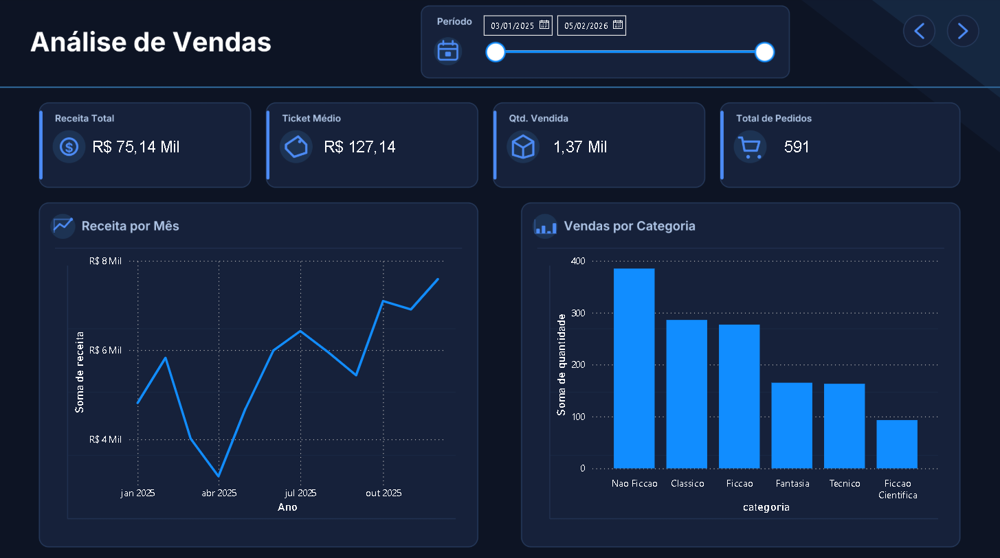
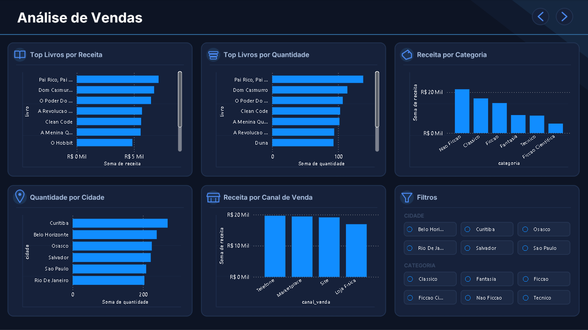

# Análise de Vendas — Distribuidora de Livros

Projeto de portfólio em **duas etapas sobre a mesma base de dados**:

1. **Limpeza e análise exploratória em Python (pandas)**: transformar uma base bagunçada, vinda de um sistema legado, em dados confiáveis.
2. **Dashboard interativo no Power BI**: usar a base tratada para construir um painel de duas páginas, com modelo de dados, medidas DAX, filtros e navegação.

<p align="center">
  
</p>

**Navegação rápida:** [Parte 1 — Python](#parte-1--tratamento-e-análise-em-python) · [Parte 2 — Power BI](#parte-2--dashboard-no-power-bi) · [Estrutura do repositório](#estrutura-do-repositório)

---

## Parte 1 — Tratamento e análise em Python

Projeto de portfólio para praticar limpeza, tratamento e análise exploratória de dados com **Python (pandas)**. A base simula o histórico de vendas de uma distribuidora de livros, extraída de um sistema antigo sem nenhum tratamento prévio.

### Contexto

O time comercial de uma distribuidora fictícia passou o histórico de vendas dos últimos meses (625 registros) diretamente de um sistema legado. Os dados chegaram com problemas comuns de bases reais: formatos de data inconsistentes, preços em texto (com `R$` e vírgula), nomes de cidade/categoria escritos de formas diferentes, quantidades negativas por erro de digitação, valores ausentes e linhas duplicadas.

O objetivo foi limpar essa base e responder perguntas de negócio que ajudassem a entender o comportamento de vendas.

### Tecnologias

- Python
- pandas / numpy
- matplotlib

### Tratamento realizado

- **Padronização de texto:** colunas de livro, autor, categoria, cidade e forma de pagamento foram normalizadas (remoção de espaços, acentos e capitalização inconsistente).
- **Correção de tipos:** `data_venda` convertida para o tipo data (aceitando os 3 formatos diferentes que vinham na base); `preco_unitario` convertido de texto (com `R$`/vírgula) para número.
- **Preços ausentes:** preenchidos com base no preço mais frequente do mesmo livro/autor/categoria, já que o preço costuma se repetir por produto.
- **Quantidades negativas:** corrigidas com valor absoluto (erro de digitação identificado na base).
- **Quantidades ausentes:** **não foram preenchidas com valores inventados.** As 10 linhas com quantidade ausente foram mantidas na base completa, mas excluídas apenas das análises que dependem de quantidade/receita, para não distorcer os números.
- **Avaliação:** valor por extenso ("cinco") convertido para número; ausências marcadas explicitamente como "Sem Avaliação" em vez de removidas.
- **Cidade e categoria:** variações como "RJ", "BH", "S. Paulo" e "Não-Ficção"/"Nao Ficcao" unificadas em um único valor por local/categoria.
- **Duplicados:** 24 linhas duplicadas identificadas e removidas antes de qualquer cálculo — no primeiro teste, elas chegaram a inflar o ticket médio em quase R$ 3,00.

### Principais insights

- **Ticket médio geral:** R$ 127,14
- **Categoria com mais receita:** Não-Ficção (R$ 21.456,09), seguida de Clássico e Ficção
- **Top livro em receita:** *Pai Rico, Pai Pobre* (R$ 7.143,18 / 138 unidades)
- **Cidade que mais compra (em volume):** Curitiba
- **Canal de venda mais forte:** Telefone, seguido de perto por Marketplace e Site — Loja Física ficou atrás
- **Mês de maior receita:** dezembro/2025 (R$ 7.589,47)

### Gráficos gerados

- Top 10 livros por receita e por quantidade (barras horizontais, em gráficos separados por escala)
- Receita por categoria (barras)
- Quantidade vendida por cidade (barras)
- Receita por mês (evolução — sazonalidade)
- Quantidade e receita por canal de venda (barras separadas)

### Como rodar

```bash
pip install pandas numpy matplotlib
jupyter notebook ProjetoPandas.ipynb
```

O arquivo `vendas_livros.csv` precisa estar na mesma pasta do notebook.

---

## Parte 2 — Dashboard no Power BI

Com a base já tratada no Python (exportada como `baseVendas.csv`), construí um dashboard de **duas páginas** no Power BI Desktop: uma visão geral dos indicadores e uma página de detalhamento, com filtros que reagem em conjunto.

### Tecnologias

- Power BI Desktop
- Power Query (linguagem M)
- DAX
- Fundo e ícones personalizados para o layout escuro

### Prévia

**Página 1 — Visão geral**



**Página 2 — Detalhamento**



### O que o dashboard entrega

| Página | Visual | O que mostra |
|---|---|---|
| 1 — Visão geral | Cartões de KPI | Receita Total, Ticket Médio, Quantidade Vendida e Total de Pedidos; a receita exibe a variação percentual vs. mês anterior |
| 1 — Visão geral | Gráfico de linhas | Receita mês a mês (usa a tabela `calendario`) |
| 1 — Visão geral | Gráfico de colunas | Quantidade vendida por categoria |
| 1 — Visão geral | Filtro de período | Seletor de datas com controle deslizante (`calendario[Date]`) |
| 2 — Detalhamento | Barras horizontais | Top livros por receita e Top livros por quantidade |
| 2 — Detalhamento | Colunas | Receita por categoria e Receita por canal de venda |
| 2 — Detalhamento | Barras horizontais | Quantidade vendida por cidade |
| 2 — Detalhamento | Filtros (slicers) | Seleção de cidade e de categoria |

**Interatividade:** os filtros de período, cidade e categoria e o clique em qualquer barra ou ponto filtram todos os outros gráficos da página (*cross-filter*). Botões de navegação no cabeçalho alternam entre as duas páginas.

### Modelo de dados

O modelo tem duas tabelas:

- **`baseVendas`** (tabela de fatos): uma linha por venda, com `id_venda`, `data_venda`, `livro`, `autor`, `categoria`, `preco_unitario`, `quantidade`, `cliente_id`, `cidade`, `forma_pagamento`, `canal_venda`, `avaliacao` e `receita`.
- **`calendario`** (tabela de datas): criada em DAX e ligada a `baseVendas` pela data da venda. Alimenta o filtro de período, o eixo de tempo do gráfico de receita e a comparação com o mês anterior.

```DAX
calendario = CALENDAR(DATE(2025, 1, 3), DATE(2026, 2, 5))
```

### Transformações no Power Query

A base chega do Python e passa por uma etapa curta de preparação no Power BI:

1. Importação do `baseVendas.csv` (14 colunas, UTF-8) e promoção da primeira linha a cabeçalho.
2. Definição dos tipos de dados (data, texto e inteiro).
3. Conversão de `preco_unitario` e `receita` usando a localidade **Inglês (EUA)**, em que o ponto é o separador decimal. Sem isso, o Power BI em pt-BR lê os valores como números inteiros e a receita fica subestimada.
4. Remoção da coluna auxiliar `mes`, já que o mês vem da tabela `calendario`.

A `receita` usada no dashboard é a calculada no Python (`preco_unitario × quantidade`), o que mantém os totais iguais aos do notebook.

### Validação dos números

Os totais do dashboard conferem com os do notebook em Python:

| Indicador | Valor |
|---|---|
| Receita total | R$ 75.138,08 |
| Total de pedidos (vendas) | 591 |
| Quantidade vendida | 1.369 |
| Ticket médio | R$ 127,14 |

### Medidas DAX

| Medida | O que calcula |
|---|---|
| `receita_total` | Soma da receita no contexto de filtro atual |
| `Total de Pedidos` | Quantidade de vendas distintas (`id_venda`) |
| `ticket_medio` | Receita total dividida pelo número de pedidos distintos |
| `receita_mes_anterior` | Receita do mês anterior ao período selecionado |
| `comparacao_receita_mes` | Variação percentual da receita em relação ao mês anterior |
| `Comparacao_Texto` | Texto do cartão de receita, como "▲ 20% vs. mês anterior", com ▲ ou ▼ conforme o sinal da variação |

```DAX
receita_total =
SUM(baseVendas[receita])

Total de Pedidos =
DISTINCTCOUNT(baseVendas[id_venda])

ticket_medio =
DIVIDE([receita_total], DISTINCTCOUNT(baseVendas[id_venda]))

receita_mes_anterior =
CALCULATE(SUM(baseVendas[receita]), PREVIOUSMONTH(calendario[Date]))

comparacao_receita_mes =
DIVIDE([receita_total] - [receita_mes_anterior], [receita_mes_anterior])

Comparacao_Texto =
VAR valor = [comparacao_receita_mes]
RETURN
IF(
    ISBLANK(valor), "",
    IF(
        valor >= 0,
        "▲ " & FORMAT(valor, "0%") & " vs. mês anterior",
        "▼ " & FORMAT(ABS(valor), "0%") & " vs. mês anterior"
    )
)
```

O cartão **Qtd. Vendida** usa a soma simples da coluna `baseVendas[quantidade]`, sem medida própria.

Notas sobre as medidas:

- **`DIVIDE`:** devolve vazio em vez de erro quando o denominador é zero, o que acontece ao filtrar um período sem vendas ou ao comparar com um mês sem dados anteriores.
- **`DISTINCTCOUNT`:** conta cada `id_venda` uma única vez, e é a base tanto do total de pedidos quanto do ticket médio.
- **`PREVIOUSMONTH`:** funções de inteligência de tempo exigem uma tabela de datas contínua, por isso a medida usa `calendario[Date]` e não a coluna de data da tabela de fatos.

### Como abrir o dashboard

1. Instale o [Power BI Desktop](https://powerbi.microsoft.com/desktop/) (gratuito, apenas Windows).
2. Abra `powerbi/BaseVendas.pbix`.
3. Se aparecer erro de fonte de dados, vá em **Transformar dados → Configurações da fonte de dados** e aponte para o arquivo `powerbi/baseVendas.csv` deste repositório.

### Próximos passos

- Tornar a tabela `calendario` dinâmica (`CALENDAR(MIN(baseVendas[data_venda]), MAX(baseVendas[data_venda]))`), em vez de datas fixas.
- Revisar títulos de eixos e nomes de categorias (acentuação) para deixar a leitura mais amigável.

---

## Estrutura do repositório

```
├── ProjetoPandas.ipynb         # notebook com todo o tratamento e análise (Parte 1)
├── vendas_livros.csv           # base de dados original (bagunçada)
├── powerbi/
│   ├── BaseVendas.pbix         # dashboard (Parte 2)
│   └── baseVendas.csv          # base tratada no Python, usada como fonte do dashboard
├── images/
│   ├── dashboard_pagina1.png
│   ├── dashboard_pagina2.png
│   └── demo_dashboard.gif
└── README.md
```
